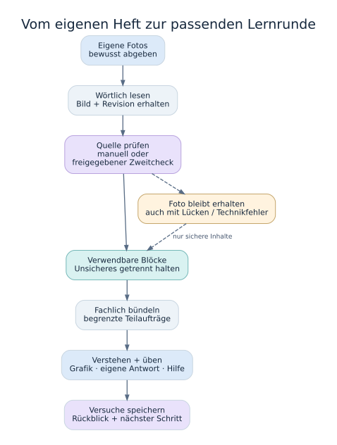
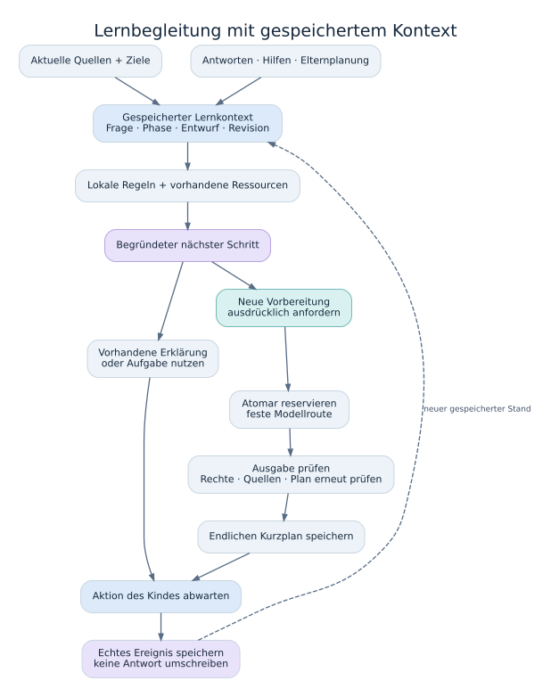
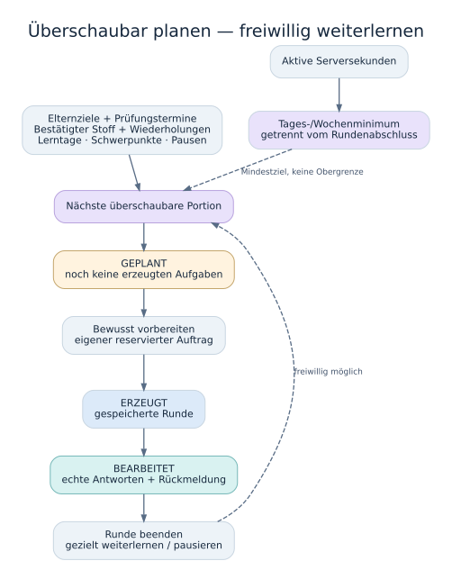
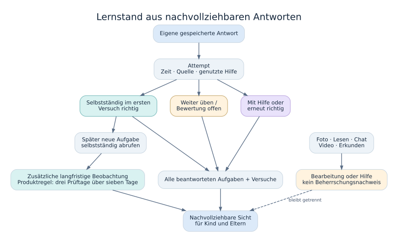

# SCHULPILOT

SCHULPILOT verbindet eigene Heftseiten mit verständlichen Erklärungen, anschaulichen Aufgaben und einem gespeicherten Lernweg. Kinder lernen in ihrem eigenen Zugang; Eltern begleiten Planung und Fortschritt. Flutter rendert dieselbe Oberfläche im Browser und nativ auf Android. Dahinter stehen eine eigene FastAPI-API, PostgreSQL und eine persistente Auftragsverarbeitung.

**[Web-App öffnen](https://schulpilot.dorfspy.de)** · [Tatsächlicher Release- und Prüfstand](docs/STATUS.md) · [Betrieb](docs/PRODUCTION.md) · [Pädagogisches Modell](docs/LEARNING_MODEL.md)

Die reguläre signierte Direct-APK ist auf der Website vor und nach der Anmeldung erhältlich. Die App ist keine Website in einer Android-WebView. Privates Schulmaterial liegt ausschließlich im eigenen Familienbereich.

> Produktionsstand: `1.36.35+147`, ausgeliefert am 26.10.2026. Automatische Heftseitenprüfung und erweiterte Fertigmeldungen sind integriert; diese Installation verwendet die automatische Zweitlesung. Der Fotoassistent öffnet die Auswahl direkt, zeigt das Foto vor den Werkzeugen und hält die Abgabe oberhalb der Vorschauen. Gewöhnliche Tinte ist von echten Korrekturen getrennt; eine unsichere Zusatzannotation verwirft nicht den ganzen gelesenen Text. Gestrichene Zahlen und Ergänzungen erscheinen getrennt in beschrifteten Karten; die laufende Zweitlesung aktualisiert die Quellenansicht ohne Neuladen. Die Glocke lässt sich direkt scrollen und bestätigt sichtbare Meldungen als gelesen. Auslieferungsbelege und Prüfgrenzen stehen in [STATUS.md](docs/STATUS.md). Ein erfolgreicher lokaler Test oder eine FCM-Annahme belegt keine sichtbare Zustellung auf einem Smartphone.

[Aktueller Alltagstest mit eigenen Heftfotos](docs/EVERYDAY_TEST_2026_10_26.md): normaler Fotoimport, unscharfe und korrigierte Stellen, Hintergrundverarbeitung, In-App-Direkteinstieg und vier abgeschlossene Testrunden. Beim bewussten Öffnen einer Aufgabenerklärung erscheinen auch die zugehörigen Hinweisgrafiken. Hardwaregrenzen sind im Prüfbericht ausgewiesen.

## Was die App unterstützt

| Bereich | Funktionen |
| --- | --- |
| **Heute** | Nächste sinnvolle Lernaktion, heutige Fotos, gespeicherte Vorbereitung, verbindliche Aufträge, anstehende Wiederholungen und gemessene Mindestlernzeit. |
| **Hefte** | Fachhefter mit echten privaten Fotos, Blättern, Zoom, Kacheln/Liste, Suche und Filtern. Aus einer oder mehreren ausgewählten bestätigten Seiten bewusst neue Übungen vorbereiten. |
| **Lernen** | Gespeicherte offene, geplante und abgeschlossene Runden; Erklärungen, gestufte Hilfe, Antworten, Rückmeldungen und Rückblicke wiederaufnehmen. |
| **Hausaufgaben** | Buch-/Arbeitsblattfotos lesen, bestätigte Aufgaben gliedern, einen eigenen Ansatz versuchen und gezielte Hilfe anfordern. Entwurf und Originalaufgabe bleiben getrennt. |
| **Klassenarbeiten / LK** | Vorbereitung mit optionalem Prüfungstermin, Themen aus eigenen Heftquellen, ausgewählten Lerntagen und individuell 1–50 Aufgaben je Thema/Lerntag; geschriebene Arbeiten importieren und Aufgaben daraus besprechen bzw. gezielt nacharbeiten. |
| **Wörter und Sprachen** | Ausdrücklich ausgewählte Wortpaare übernehmen, Richtungen/Fähigkeiten getrennt üben und spätere Wiederholungen verwenden. Sprachprojekte haben einen eigenen begrenzten Vertrag. |
| **Schulbuddy** | Kontextbezogene Nachfragen zu eigenen Seiten und laufenden Übungen; Quellen und bereits gegebene Hilfe berücksichtigen. Ein Chat ist kein Leistungsnachweis. |
| **Eltern** | Kinderzugänge und Familienrechte, Lerntage/Mindestzeiten, Pausen, Themen, Aufträge, Prüfungsvorbereitung, tatsächliche Antworten/Hilfen und Schulnoten verwalten. |
| **Betrieb** | Einrichtung, Eltern-/Kinderkonten als Verwaltungsmetadaten, revisionsgebundene Einstellungen, Kostenkontrollen, Anbieterfreigaben, Notfallstopp und Audit. Administratoren lesen keine privaten Heftseiten oder Antworten. |

Die gemeinsame Workspace-Navigation passt sich an Smartphone, Tablet und breite Browserfenster an. Sammlungen laden begrenzte Metadaten und Fotos bei Bedarf. Ein geöffnetes Heft, ein Filter oder eine Statusabfrage erzeugt keine KI-Kosten und keinen Lernfortschritt.

## Von eigenen Fotos zur Lernrunde



[Diagrammquelle: Mermaid](docs/diagrams/learning-flow.mmd) · [Graphviz](docs/diagrams/learning-flow.dot)

1. **Fotos ausdrücklich abgeben.** Bilder zuschneiden, drehen und sortieren. Der vorhandene Worker liest jede Seite als eigenen, regulär reservierten Auftrag; Schließen oder Neuladen startet keinen zweiten Auftrag.
2. **Wortlaut und Unsicherheit trennen.** Die Abschrift erhält Textblöcke, Formeln, sichtbare Schülerfehler und Korrekturen. Quellenversionen und Bildherkunft bleiben nachvollziehbar. Eine gelesene bzw. bestätigte Seite beweist weder fachliche Richtigkeit noch Können.
3. **Verwendbare Grundlagen auswählen.** Unsichere Stellen, sichtbare Schülerantworten und erkannte falsche Gleichungen werden nicht still als richtige Lehrregel verwendet. Geeignete Seiten werden fachlich gebündelt.
4. **Überschaubare Runden vorbereiten.** Größere Pakete verwenden vorhandene, persistente Teilaufträge mit eigenen Reservierungen. Fertige Teilrunden und alte Antworten bleiben erhalten. Weitere Etappen werden bewusst angefordert.
5. **Verstehen, üben und zurückblicken.** Erklärungen, Modelle und kleine Aufgaben bilden einen Lernweg; gespeicherte Versuche und Hilfen bestimmen das gezielte Weiterlernen.

Neue Installationen beginnen mit ausdrücklicher manueller Quellenbestätigung. Der Admin kann `manual` oder `automatic` revisionsgebunden einstellen; die Produktionsinstallation verwendet seit Version142 `automatic`. Im Automodus folgt auf eine erste Heftabschrift genau ein eigener Bild-/Abschriftgegencheck. Korrigierbare Lesefehler werden anhand des Fotos behandelt; unleserliche Bereiche bleiben markiert und vom bewerteten Lernen ausgeschlossen. Ein technischer Fehler wird nicht als geprüfter Erfolg ausgegeben und hält andere Seiten nicht auf. Die bisherigen Originale, Fehler, Kosten und Versuchszähler bleiben erhalten. Ein Moduswechsel allein verarbeitet keinen alten Familienbestand. Hausaufgaben- und Klassenarbeits-Spezialabläufe sowie die ausdrückliche Wortübernahme behalten ihre eigenen Regeln.

Mehr: [Fotoassistent](docs/AFTER_SCHOOL.md), [Paket-Teilaufträge](docs/PACKAGE_PARTS.md), [Fachhefter](docs/NOTEBOOKS.md), [Quellenlöschung](docs/SOURCE_DELETION_2026_10_20.md).

## Wie die Lernbegleitung entscheidet



[Diagrammquelle: Mermaid](docs/diagrams/learning-controller.mmd) · [Graphviz](docs/diagrams/learning-controller.dot)

Die Lernbegleitung liest den aktuellen Quellenstand, vorhandene Lernziele, tatsächliche Antworten, genutzte Hilfen und die Elternplanung. Zuerst nutzt sie gespeicherte Inhalte und passende lokale Regeln bzw. Katalogressourcen. Bei einer ausdrücklich angeforderten neuen Vorbereitung wird ein begrenzter Auftrag reserviert; erst eine geprüfte und zum weiterhin gültigen Kontext passende Antwort wird gespeichert.

Das Arbeitsgedächtnis enthält aktuelle Frage, Phase, Entwurf, Hilfen und einen endlichen Kurzplan. Gerätekonflikte oder geänderte Quellen dürfen diesen Stand nicht still überschreiben. Ein Modellvorschlag ändert keine früheren Antworten und setzt keine offene Antwort nachträglich auf „richtig“. Widersprüche bleiben ein Klärungsfall.

Eine Erklärung oder ein eigener Selbstversuch kann den Einstieg bilden. Benötigte Grundlagen werden dort gezielt geprüft, wo passende vorhandene Ziele und Referenzen das tragen. Die App besitzt **keinen vollständigen Kompetenzgraphen für jeden Schulstoff**. Hinweise auf Schwierigkeiten sind vorläufige, beleggebundene Beobachtungen und keine pädagogische Diagnose.

Umsetzung: [learning_controller.py](backend/schulpilot/learning_controller.py), [LearningMemory](backend/schulpilot/db.py), [coaching.py](backend/schulpilot/coaching.py), [Ausführbare Lernsteuerung](docs/LEARNING_CONTROLLER_2026_10_20.md), [Hefttutor](docs/STUDY_PATH_TUTOR.md).

## Lernplan und Mindestlernzeit



[Diagrammquelle: Mermaid](docs/diagrams/learning-plan.mmd) · [Graphviz](docs/diagrams/learning-plan.dot)

Eltern legen Lerntage, Mindestzeiten, Schwerpunkte, Pausen und verbindliche Ziele fest. Vorhandene Schulnoten können die Gewichtung innerhalb der Planung beeinflussen. Prüfungstermine und konkrete Aufträge behalten ihren Platz. Ein Siebentagevorschlag verteilt bekannte Etappen; verpasste Tage erzeugen keinen wachsenden Pflichtberg.

**Tages- und Wochenminuten sind Mindestziele.** Sie sperren freiwilliges Weiterlernen nicht. Eine fachlich abgeschlossene Runde darf auch vor dem Zeitminimum enden. Die App trennt den Abschluss dieser Runde, das gemessene Zeitminimum und längerfristige fachliche Festigung.

Geplante Aufgaben sind noch nicht erzeugte Aufgaben; erzeugte Aufgaben sind noch nicht beantwortet. Aktivitätszeit stammt aus gespeicherten Serversekunden während tatsächlicher sichtbarer Nutzung. Mehrere Geräte dürfen Zeit nicht doppelt zählen. Die Zeitmessung ist eine Näherung, keine manipulationssichere Anwesenheitskontrolle.

Mehr: [Täglicher Ablauf](docs/DAILY_ROUTINE.md), [Lernmodell](docs/LEARNING_MODEL.md), [Klassenarbeiten](docs/EXAMS.md), [Elternbegleitung](docs/PARENT_LEARNING.md).

## Was als Lernstand zählt



[Diagrammquelle: Mermaid](docs/diagrams/learning-evidence.mmd) · [Graphviz](docs/diagrams/learning-evidence.dot)

Alle tatsächlich beantworteten Aufgaben zählen, auch in begonnenen und freiwilligen Runden. Aufgabe und Versuch bleiben unterschiedliche Größen. Die Anzeige unterscheidet selbstständig im ersten Versuch richtig, mit Hilfe bzw. erneut richtig, weiteren Übungsbedarf und offene Bewertung. Frühere Antworten und Hilfen werden für bessere Statistiken nicht umgeschrieben.

Daneben beobachtet die langfristige Sicht spätere selbstständige Abrufe mit passenden Quellenrevisionen und neuen Aufgaben. Die Produktregel von mindestens drei Prüftagen über sieben Tage ist eine dokumentierte Einordnung, kein wissenschaftlicher Beweis dauerhafter Beherrschung. Alte Antworten ohne belegten damaligen Quellenstand bleiben in der Übungszählung erhalten, werden aber nicht nachträglich zu aktuellen sicheren Kompetenzbelegen.

Uploads, Erklärungen lesen, Videos ansehen, Chat, Regler bedienen und Lösungen aufdecken erzeugen für sich **keinen Beherrschungsnachweis**. Relevante Hilfe bei einer noch offenen Aufgabe kennzeichnet eine spätere Lösung als unterstützt.

Umsetzung: [learning.py](backend/schulpilot/learning.py), [learning_knowledge.py](backend/schulpilot/learning_knowledge.py), [coaching.py](backend/schulpilot/coaching.py), [Berechnung und pädagogische Grenzen](docs/LEARNING_MODEL.md).

## Grafiken, Animationen und Medien

Darstellungen verwenden strukturierte, versionierte Daten und vorhandene Flutter-Renderer. Die Aufgabenerstellung erhält die tatsächlich für Fach, Fragetyp und Offenlegungsstufe verfügbaren Fähigkeiten. Die App prüft Quellen, Referenzversionen, Zahlen, Beschriftungen und zulässige Zustände; sie führt keinen vom Modell erzeugten HTML-, SVG- oder Programmcode aus.

Vorhanden sind unter anderem Bruch-/Flächenmodelle, Satz- und Wortkarten, Zeitachsen, Funktionen, Messpunkte, Logiktafeln, Prozessfolgen und deklarative Szenen. Geeignete Interaktionen verändern einen Parameter, einen markierten Schritt oder eine erlaubte Ansicht. Zuordnungen unterstützen Tippen, Tastatur und Drag-and-drop. Eine deklarative Szene ist keine beliebige physikalische Simulation. Bedienumfang und fachliche Grenzen stehen im [Darstellungskatalog](docs/AI_RENDER_CAPABILITIES.md).

Die Referenzdatenbank steuert private quellengebundene Aufgaben. Der getrennte [Bausteinpfad](docs/GENERATED_LEARNING_ASSETS.md) kann auf bewusste Anfrage allgemeine öffentliche KI-Erklärungen mit einer vorhandenen Szene erzeugen und unverändert wiederverwenden. Er erhält keine privaten Hefttexte oder Antworten. Diese Bausteine sind als **unbewertete Erkundung** gekennzeichnet und liefern keine neuen geprüften Antwortschlüssel.

[Sofatutor und weitere Katalogeinträge](docs/CATALOG_INTEGRATION.md) werden anhand vorhandener Metadaten gesucht. Gezeigt werden tatsächlich gespeicherte Links; ein fehlender Treffer blockiert den Lernweg nicht. Ein Titel ist kein Beleg dafür, dass die App das gesamte Video kennt. Externe Angebote können Anmeldung oder ein eigenes Abonnement benötigen.

## Fächer, Schulprofil, Wörter und Arbeiten

- **Schulprofil:** Bundesland, angebotene Schulform und Klasse pro Kind. Der versionierte [Lehrplanbestand](docs/CURRICULUM.md) deckt Teile aller 16 Bundesländer ab, ist ausdrücklich unvollständig und keine vollständig geprüfte Sammlung für jede Schulform/Klasse 1–13. Klassenbänder werden nicht als exakte Einzelklassen ausgegeben. Heftquellen bleiben maßgeblich.
- **Wörter/Sprachen:** Erkannte Wortpaare werden vor Übernahme einzeln ausgewählt und bestätigt. Sprache, Variante, Richtung und Fähigkeit werden ausdrücklich geführt. Erlaubte Antworten sind quellengebunden; unbekannte freie Sätze bleiben gegebenenfalls unklar. Aufdecken und Hilfe sind keine selbstständigen Abrufbelege. [Vertrag](docs/LANGUAGE_LEARNING.md).
- **Hausaufgaben:** Hilfe erklärt den nächsten Schritt und erhält den eigenen Entwurf. Foto, Originalaufgabe und selbst abgehakte Erledigung sind kein unabhängiger Leistungsnachweis. [Werkstatt](docs/HOMEWORK.md).
- **Geschriebene Arbeiten:** Originalaufgabe, alte Kinderantwort, sichtbare Rückmeldung und KI-Vorschlag bleiben getrennt. Die Besprechung behauptet keine neue Lehrernote und keine vollständige Korrektur aller Aufgaben. Neue Übungen entstehen aus geeigneten bestätigten Grundlagen. [Vor- und Nachbereitung](docs/EXAMS.md).
- **Schulnoten:** Nur berechtigte Eltern verwalten sie; an den Aufgabenprovider geht eine abgeleitete Strategie statt privater Noten/Notizen. Fuxnoten-PDFs werden lokal begrenzt gelesen und vor Übernahme geprüft, nicht an KI gesendet. [Lernmodell](docs/LEARNING_MODEL.md), [PDF-Import](docs/GRADE_PDF_IMPORT.md).
- **Vorlesen/Sprechen:** Ausschließlich nach bewusster Aktion. Sprachdienst und mögliche Onlineverarbeitung werden erklärt; Tippen und Lesen bleiben nutzbar. Sprachaufnahme ist keine Aussprachebewertung.

## Familie, Nachrichten und Betrieb

Ein Elternkonto wird mit bestätigter E-Mail angelegt; berechtigte Eltern erstellen eigene Kinderzugänge. Eingeladene Erwachsene erhalten ausdrücklich Lese- oder Verwaltungsrechte. Optionaler Google-Elternzugang verwendet OpenID Connect über die eigene API, keine Firebase Authentication und keine automatische Kontozusammenführung anhand einer E-Mail.

Die Glocke bietet kontogebundene In-App-Neuigkeiten ohne Firebase-Opt-in. Im Glockenmenü sind bis zu 50 geladene Meldungen direkt scrollbar; dort und unter „Alle anzeigen“ werden tatsächlich sichtbare Karten als gelesen bestätigt. Optionales Geräte-Push benötigt eine eigene Gerätefreigabe; beim Kind zusätzlich die Elternfreigabe. Ruhezeiten, aktive Sitzungen und aktuelle Rechte werden vor Versand geprüft. FCM transportiert neutrale Texte und erlaubte lokale Ziele, keine Heftinhalte, Antworten oder Noten. Ein vom Anbieter akzeptierter Push ist noch keine auf dem Gerät beobachtete Zustellung. Neue, erfolgreich gespeicherte Runden erhalten einen deduplizierten Inboxbeleg und einen direkten Link auf die tatsächlich bereite eigene Runde; reine Fotoablage bleibt ehrlich beim Schultag. [Benachrichtigungen](docs/NOTIFICATIONS.md), [Google-Zugang](docs/GOOGLE_LOGIN.md).

[Familienanrufe](docs/FAMILY_CALLS.md) erlauben ausdrücklich gestartete Livehilfe mit Mikrofon, optionaler Kamera und gesonderter Bildschirmfreigabe. Die Aufgabe bleibt dabei geöffnet. Schulpilot zeichnet Gespräche nicht auf und bietet keine Fernsteuerung; TURN-Relay, Gerätefreigaben und eine eigens aktivierte Installation sind Voraussetzungen. Angenommene Hilfe wird bei neuen Antworten als Unterstützung geführt.

Der Betriebsadmin verwaltet Installation, Benutzer-/Familienmetadaten, Provider und Budgets. Tages- und Monatskostenlimits sind je Kind getrennt aktivierbar, einschließlich `unbegrenzt`; globale Betriebssperren, Tarife, Datenschutzfreigaben und feste Anbietergrenzen bleiben separat wirksam. Bekannte OpenRouter-Preise werden über vorhandene Generierungsbelege abgeglichen. Unbekannte Kosten bleiben unbekannt und behalten ihre Reservierung. [Kostenvertrag](docs/CHILD_COST_CONTROLS.md), [Benutzerverwaltung](backend/schulpilot/admin_users.py).

Der Webverkauf verwendet feste vorausbezahlte Laufzeiten ohne automatische Verlängerung. Vorhandene Wege für Überweisung und gesondert freizugebende Wallet-Zahlungen ersetzen keine tatsächliche Händler-, Bank- oder Betreiberfreigabe. Fehlende Pflichtangaben halten den Verkauf gesperrt; Kinder und Play-Client erhalten keine Kaufwerbung. [Zahlungs- und Vertragsweg](docs/PAYMENTS.md).

## Architektur und Datenverträge

| Teil | Verantwortung |
| --- | --- |
| `app/lib` | Gemeinsamer Flutter-Client, rollenbezogene WorkspaceShell, Pfadrouting, native Android-Ergänzungen. |
| `materials`, `extraction`, `source_lineage` | Private Fotos, wörtliche Erfassung, Quellenrevisionen und konservative Lernquellenprojektion. |
| `school_preparation`, `package_partitions`, `study_path` | Dauerhafte Tagesabgabe, begrenzte Teilaufträge, gespeicherte Etappen und bewusstes Weiterlernen. |
| `learning`, `coaching`, `learning_controller`, `learning_knowledge` | Antworten/Versuche, Hilfen, Rückblicke, aktuelle Entscheidungen und langfristige Belege. |
| `subject_content`, `visual_references`, `learning_assets` | Geschlossene Fach-/Darstellungsverträge, private Grafikbelege und getrennte öffentliche Erkundungsbausteine. |
| `providers`, `model_routing`, `ai_accounting` | Feste Adapter, reservierte Auswahl, Kostenabrechnung und Metadatenabgleich. |
| `worker` | Vorhandene persistente DB-Queue; kein zusätzliches Redis-/RabbitMQ oder Microservice nötig. |

PostgreSQL ist die Betriebsdatenbank, SQLite die lokale/Testalternative. SQLAlchemy und Alembic verwalten Modelle und Migrationen. Private Fotos liegen außerhalb des Webroots und werden nur authentifiziert ausgeliefert.

Vor und nach Anbieteraufrufen gelten Rollen-, Familien-, Sitzungs-, Quellen-, Planungs- und Providerprüfungen gemäß dem jeweiligen Auftragsvertrag. Höchstens ein aktiver bezahlter Kinderauftrag, atomare Reservierung, feste Modelle/Upstreams, begrenzte Versuche und kein automatischer Anbieterfallback. Größere Aufgabenmengen bedeuten mehrere einzelne Aufträge, nicht eine unbegrenzte Wiederholung.

OpenRouter, der direkte OpenAI-Adapter und ein eigens isolierter Codex-Worker sind vorhandene Wege. Die tatsächlich aktivierte und abgenommene Route steht im Betriebsstand; Modelle oder Preise werden hier nicht als dauerhaft aktuell behauptet. Neue Installationen benötigen eine ausdrückliche Konfiguration/Freigabe. Ein Codex-Kontozugang weist keine verlässlichen USD-Kosten aus und gilt deshalb nicht als kostenlos. [Anbieter](docs/PROVIDERS.md), [Modellmix](docs/ADAPTIVE_OPENROUTER.md), [Codex-Isolation](docs/CODEX.md).

## Lokal starten

Die fixierte Toolchain steht in [toolchain.json](toolchain.json): Flutter **3.47.7**, Dart **3.13.5**, Python **3.12.3**. Paketstände liegen in `app/pubspec.lock`, `backend/requirements.lock`, `backend/requirements-dev.lock` und `qa/package-lock.json`.

```bash
python3 -m venv .venv
.venv/bin/pip install -r backend/requirements-dev.lock
cd app
flutter pub get --enforce-lockfile
flutter build web --release --no-web-resources-cdn --csp
cd ..
bash scripts/run-local.sh
```

Danach `http://localhost:8080` öffnen. Eine neue leere Installation führt in den lokal freizuschaltenden [Einrichtungsassistenten](docs/INSTALLATION.md). Bestehende Familien öffnen ihn nicht erneut. `.env.example` beschreibt lokale Variablen; eine `.env` wird nicht automatisch ausgeführt. Infrastrukturgeheimnisse und `MASTER_KEY` bleiben außerhalb von Git. Veränderbare Betriebswerte werden verschlüsselt gespeichert.

## Tests, Releases und Sicherheit

```bash
PYTHONPATH=backend .venv/bin/pytest -q
.venv/bin/ruff check backend deploy scripts workers
cd app
flutter analyze
flutter test
```

PostgreSQL-Tests benötigen eine eigene Testdatenbank mit dem Suffix `_test`; niemals eine Betriebsdatenbank verwenden. Reale Kinderdaten gehören nicht in Fixtures. Anbieter-Smokes verwenden feste künstliche Inhalte und eigene begrenzte Freigaben; ein Demo-Flag erlaubt keine freien externen Prompts. [Prüfkatalog](docs/QUALITY.md), [CI-Workflow](.github/workflows/checks.yml).

`bash scripts/build_release.sh` baut Web, signierte Direct-APK und Play-AAB mit fixierter Toolchain. Signierschlüssel und Firebase-Dienstkonto liegen außerhalb von Git. Deployment prüft tatsächliches Paket, Signierer, Versionsstand, Debug-Flag und Artefakthashes. Der native Direct-Updater prüft beim Kaltstart und nach Rückkehr aus dem Hintergrund; Play verwendet ausschließlich seinen eigenen Updateweg. [Android-Updates](docs/ANDROID_UPDATES.md), [Betrieb und Rückweg](docs/OPERATIONS.md).

Rollen werden ausschließlich im Backend autorisiert. Passwörter sind mit Argon2id gehasht, Sitzungen widerrufbar. Kinderinhalte, Bilder, Tokens, Passwörter und Provider-Schlüssel werden nicht protokolliert oder committet. Export, Löschung, Aufbewahrung und Wiederherstellung gehören zum bestehenden Datenvertrag. Eine Schema-/Browserprüfung ersetzt weder fachliche Stichproben noch beobachtete Bedienung auf realer Hardware; Notenverbesserung ist ein Ziel, keine zugesicherte Wirkung.

## Dokumentation

[Architektur und Rechte](docs/ARCHITECTURE.md) · [Gestaltung](docs/DESIGN_SYSTEM.md) · [Einrichtung](docs/INSTALLATION.md) · [Lernmodell](docs/LEARNING_MODEL.md) · [Geprüfte Quellen/Versionen](docs/SOURCES.md) · [Abnahmen und offene Grenzen](docs/STATUS.md)

Die vier Abbildungen sind eigene, datenfreie SVG-Diagramme. Ihre [Mermaid- und Graphviz-Quellen](docs/diagrams/README.md) liegen im Repository und lassen sich lokal ohne KI- oder Netzwerkaufruf neu rendern.
